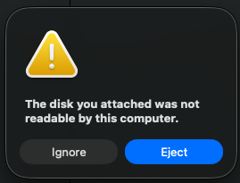

# Provo Craft CD Recovery

Scripts for preserving and modernizing the 1996 Provo Craft electronic clip-art CD-ROM collection.

Every title documented here so far is marked **copyright August 1996**. The shared month and year suggest these boxes were released as a contemporaneous collection.

This repository contains **scripts only**. It does not include disc images, clip art, fonts, or other recovered assets. The MIT License applies only to this repository's scripts and documentation; all extracted CD content remains subject to its original copyright and license terms. See [CONTENT_RIGHTS.md](CONTENT_RIGHTS.md).


## Recover an inserted disc

```bash
python3 scripts/recover_cd.py recover
```

It detects the inserted CD-ROM drive, reads the classic-Mac HFS volume name, and writes the full result to `CD/<detected-disc-name>/`. Every major step and conversion batch is printed as it runs; raw capture also exposes `dd` progress while the CD spins. After a successful recovery, it ejects the disc. That Git-ignored folder includes the raw archive in `archive/`, root-level contact sheets and converted TTF fonts, plus `PNG/` and `SVG/` directories. Re-running it fingerprints the inserted disc, finds any matching local archive, and skips archive, image, font, SVG, and contact-sheet files that already exist.

## Why the scripts are necessary

When this disc is inserted into a current Mac, macOS recognizes that a disk arrived but offers no readable files:



The recovery workflow captures the raw sectors before conversion, then uses HFS-aware tooling to export the artwork and legacy fonts without asking macOS to initialize, repair, or overwrite the disc.

## Original system requirements, circa 1996

The discs asked for what was then a serious workstation:

| Platform | Original requirements |
| --- | --- |
| Windows | Windows 3.1 or later with TrueType support, **4 MB RAM**, **4–8 MB hard-disk space**, and a graphics program that supports TIFF |
| Macintosh | System 6 or later (System 7 recommended), **4–8 MB disk space**, **4–8 MB RAM**, and a graphics program that supports TIFF or EPS |

In other words: this project turns media designed for a computer with less memory than a modern browser tab into files useful on a current Mac. The recovery scripts keep the original formats intact while producing low-depth PNG, SVG, modern TTF, and thumbnail contact-sheet derivatives.

## Compatibility notes from the manuals

The manuals were frank that these CDs were **not easily DOS-compatible**. Their format choices were deliberately practical for the 1990s:

- **Streamlined EPS** was presented as a Macintosh-only feature. It was recommended because artwork could be redrawn whenever it was changed.
- **TIFF** was the fairly universal option: designed to be straightforward to use in graphics and drawing programs.
- Some discs included grayscale TIFFs as a bonus for people with enough memory to work with them.
- One insert warned that PrintShop could import only 256-color TIFFs. It listed The Print Shop Ensemble, Ensemble II, Ensemble III, and The Print Shop Deluxe II as unable to accept those images; older editions of The Print Shop Deluxe, limited to 16-color TIFFs, could import the graphics.
- The **Countryside Collection** insert directed The Print Shop Deluxe II and all Print Shop Ensemble users to the WMF files; its TIFF files were for The Print Shop Deluxe. For Paintbrush for Windows 95, it specifically said not to **Open** the TIFFs: use **Edit → Paste From**, select **All File Formats**, and import the TIFF from there.

The manuals named a period software shelf that included QuarkXPress, WordPerfect 5.0+, Microsoft Word 5.0+, ClarisWorks, CorelDRAW! 4.0+, Draw 4.0, Aldus PhotoStyler, Adobe Photoshop, Adobe Illustrator 3.0, Microsoft Works 4.0, Aldus PageMaker 4.0+, Print Artist 3.0+, The Print Shop Deluxe/II/III, and Adobe PhotoDeluxe.

This project leans into that history while widening compatibility for current software: TIFF artwork becomes compressed PNG files with only edge-connected white made transparent, EPS becomes standalone SVG, readable Macintosh `.suit` resources become modern TTFs, and contact sheets make the recovered collection browsable without flipping through the manuals' dead trees.

## Acquisition story

The recovery set began with seven Provo Craft boxes found at an annual library book sale on the final **Name Your Price Day**. The lot cost $5, supporting the library; that same five dollars also covered *Spinal Tap: Break Like the Wind*, an Ear Food album originally marked $6.99 and later stickered at $0.50. Its eventual export will, appropriately, go to 11.

## Disc credits noted on the packaging

- **All Occasions** — Annette Ward; copyright August 1996.
- **All Creations** — copyright August 1996; product no. 40-6072.
- **Garden Party** — Rebecca Carter; copyright August 1996; product no. 40-6069.
- **Countryside Collection** — Kathy Distefano Griffiths; copyright August 1996; product no. 40-6070.
- **Four Seasons** — Kathy Distefano Griffiths; copyright August 1996; product no. 40-6071.
- **Rebecca's Winter Weather** — Rebecca Carter; copyright August 1996; product no. 40-6068.
- **Holidays** — Annette Ward; copyright August 1996; product no. 40-6073.

## Recovery status

| Disc | Product no. | Output folder | Credited creator | Copyright | PNG | SVG | Font | Status |
| --- | --- | --- | --- | --- | ---: | ---: | --- | --- |
| All Occasions | — | `CD/all-occasions` | Annette Ward | August 1996 | 202 | 202 | `ALL OCCASIONS Normal.ttf` | Recovered. |
| Garden Party | 40-6069 | `CD/garden-party` | Rebecca Carter | August 1996 | 217 | 217 | `Garden Party Normal.ttf` | Recovered. |
| Countryside Collection | 40-6070 | `CD/countryside` | Kathy Distefano Griffiths | August 1996 | 215 | 215 | `Countryside Normal.ttf` | Recovered. |
| Four Seasons | 40-6071 | — | Kathy Distefano Griffiths | August 1996 | — | — | — | Not yet recovered. |
| Rebecca's Winter Weather | 40-6068 | `CD/winter-weather` | Rebecca Carter | August 1996 | 216 | 216 | `Winter Weather Normal.ttf` | Recovered. |
| Holidays | 40-6073 | — | Annette Ward | August 1996 | — | — | — | Being processed. |

## What it does

`scripts/recover_cd.py` supports two steps:

1. `archive` preserves a Mode-1 CD as a raw 2352-byte-sector `.cdr` capture, generates a derived 2048-byte `.iso`, and writes a SHA-256 checksum.
2. `build` takes a previously extracted classic-Mac CD folder and creates a clean folder for one disc containing:

   ```text
   <output>/<disc-name>/
   ├── contact-sheet-01.png
   ├── contact-sheet-02.png
   ├── ...
   ├── <font name>.ttf            # when a Macintosh .suit is present
   ├── PNG/
   ├── SVG/
   ├── manifest.json
   └── README.txt
   ```

The root contact sheets use labeled 8×8 thumbnail grids. Labels show the source category folder and filename without the extension.

## Requirements

The scripts target macOS and require:

- Python 3.11+
- ImageMagick (`magick`)
- pstoedit (`pstoedit`)
- FontForge (`fontforge`)

Install them in one step with Homebrew:

```bash
./scripts/setup_macos.sh
```

The script uses the checked-in `Brewfile`, so it is safe to re-run.

For a classic Macintosh HFS disc, extract the source folders first with an HFS-aware tool such as `hfsutils`. Preserve legacy fonts in MacBinary form so both forks survive.

## Build a modern asset folder

The input folder must contain `TIFF/`, `EPS/`, and, when available, `FONT (original Mac files)/` with a `*.suit.bin` MacBinary font resource.

```bash
python3 scripts/recover_cd.py build \
  "/path/to/extracted-disc" \
  "/path/to/recovered-discs" \
  --disc-name "All Occasions"
```

The converter derives each output TTF filename from its `.suit` source. Use `--font-name "Custom Name"` only to override that name. Use `--overwrite` only when you intend to replace an existing generated per-disc folder.

## Preserve a raw optical-disc image

```bash
python3 scripts/recover_cd.py archive \
  "/path/to/archive/all-occasions.cdr"
```

`archive` automatically detects the inserted CD-ROM drive with macOS `drutil`. Use `--device /dev/rdisk12` only if automatic detection picks the wrong drive. The archive step expects raw Mode-1 CD sectors and never writes to the optical disc.

## Development

```bash
python3 -m unittest discover -s tests -v
```

## Status

The initial workflow has been tested against the recovered **All Occasions** disc layout: 202 TIFF-to-1-bit-PNG conversions, 202 EPS-to-SVG conversions, direct Macintosh `.suit` to TTF conversion, and four packed contact sheets.
